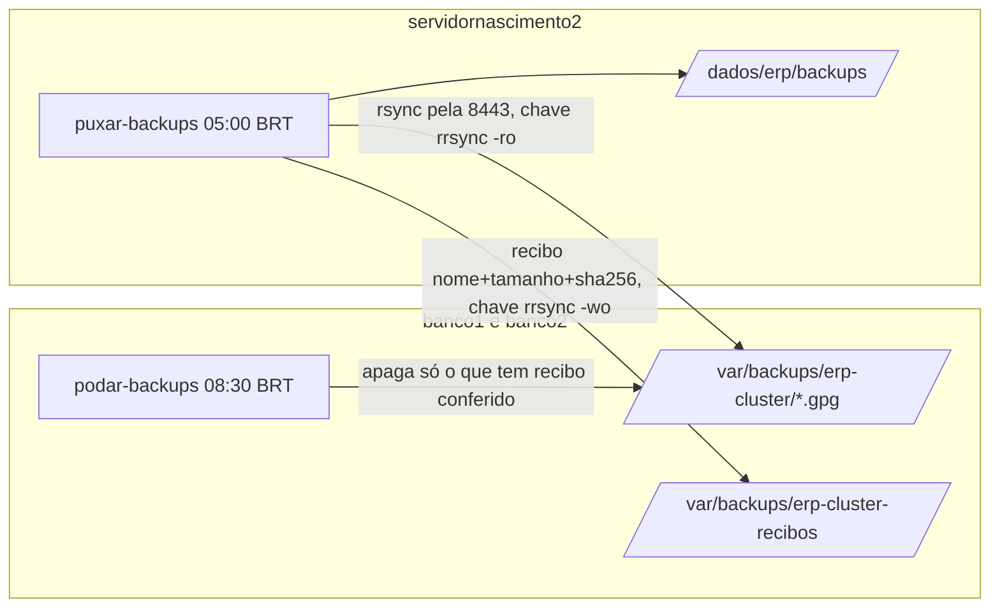

# Servidor da empresa — `servidornascimento2`

Servidor físico na rede interna (`192.168.100.59`, Ubuntu 26.04, 6 núcleos,
15 GB, NVMe 2 TB + HD WD Red 2 TB). Configurado em 18/11/2026 para guardar os
backups cifrados que saem da nuvem — o disco do banco2 tinha chegado a 91%
(ver `docs/incidentes/2026-11-13-api-banco1-fora.md`).

O mapa de pastas para quem entra por SSH está em [`LEIA-ME.txt`](LEIA-ME.txt)
(a mesma cópia fica em `/dados/erp/LEIA-ME.txt` no servidor).

## Como funciona



- **O servidor da empresa puxa**: nenhuma porta aberta no roteador, e um nó
  comprometido não alcança a rede interna. Saída pela 8443 (a rede da empresa
  bloqueia a 22).
- **Nada sai da nuvem sem estar aqui inteiro**: `infra/ha/podar-backups.sh`
  só apaga com recibo do mesmo tamanho; banco com mais de 3 dias, anexos menos
  o mais novo. Sem recibo, vale a retenção antiga (14 dias / 2 cópias).
- **Retenção aqui**: banco 365 dias, anexos 12 cópias por nó.
- **Tudo cifrado**: a chave privada GPG do Eduardo não está aqui nem nos nós.

## Peças

| Onde | O quê |
|---|---|
| `/dados` | LV `ubuntu-vg/dados`, 1,5 TB, **raid1 LVM** (NVMe + `sda`), ext4, `nofail` no fstab |
| usuário `erpcopia` | sistema, sem login; dono de `/dados/erp`; chaves em `/var/lib/erpcopia/.ssh/{leitura,recibos}` |
| `/usr/local/sbin/puxar-backups` | [`puxar-backups.sh`](puxar-backups.sh) |
| `puxar-backups.timer` | `OnCalendar=*-*-* 08:00:00 UTC`, `Persistent=true` (servidor desligado na hora → roda ao ligar) |
| nos nós, `/home/erpbackup/.ssh/authorized_keys` | `command="/usr/bin/rrsync -ro /var/backups/erp-cluster",restrict` e `command="/usr/bin/rrsync -wo /var/backups/erp-cluster-recibos",restrict` (backup do arquivo antigo: `.bak-20261118`) |
| nos nós, `podar-backups.timer` | `OnCalendar=*-*-* 11:30:00 UTC` |

## Reinstalar do zero

```bash
# disco (APAGA o sda): pvcreate /dev/sda; vgextend ubuntu-vg /dev/sda
lvcreate --type raid1 -m1 -L 1.5T -n dados ubuntu-vg /dev/nvme0n1p3 /dev/sda
mkfs.ext4 -L dados -m 1 /dev/ubuntu-vg/dados   # + linha UUID=... /dados ext4 defaults,nofail no fstab
useradd --system --create-home --home-dir /var/lib/erpcopia --shell /usr/sbin/nologin erpcopia
sudo -u erpcopia ssh-keygen -t ed25519 -N "" -f /var/lib/erpcopia/.ssh/leitura   # e .../recibos
install -m 0755 puxar-backups.sh /usr/local/sbin/puxar-backups
# units: Type=oneshot, User=erpcopia, Nice=10, IOSchedulingClass=idle, RequiresMountsFor=/dados
```

Primeira carga são ~32 GB (16 GB por nó): rodar de noite, ou de dia com
`BWLIMIT=5000` (KB/s). Teste com um arquivo só:
`sudo -u erpcopia env SO='erp-cluster-20261118-*' BWLIMIT=5000 /usr/local/sbin/puxar-backups`.

## Pendente

- **IP fixo**: hoje vem do DHCP do roteador. Reservar `192.168.100.59` para o
  MAC da `enp2s0` no roteador.
- Falha do `puxar-backups` só fica no log e no journal (a nuvem registra
  `ATENCAO: o servidor da empresa nao confirma backup ha Nh` depois de 48 h).
  Se o disco do nó voltar a encher, o alerta "Disco > 85%" do Grafana avisa.
